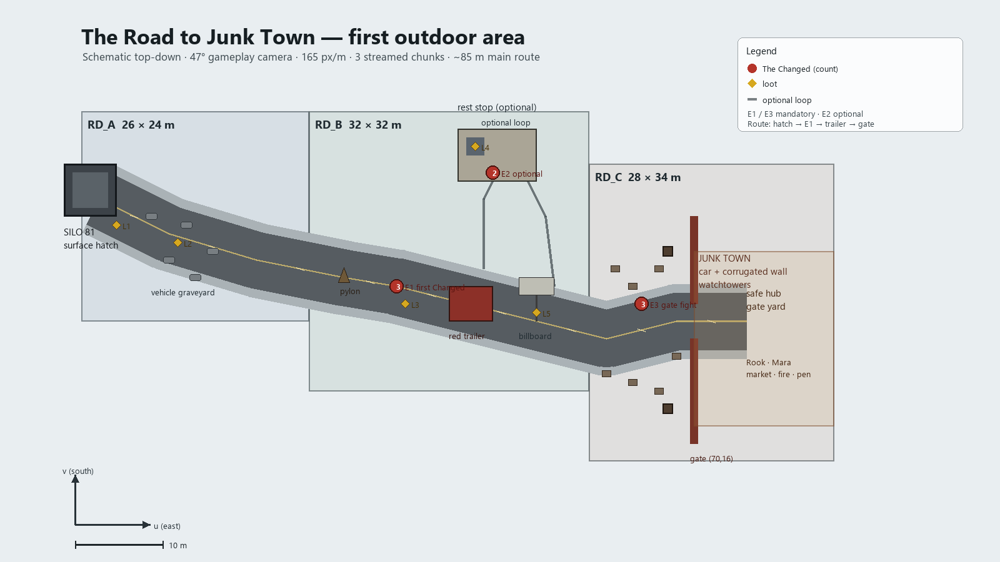

# The Road to Junk Town — first outdoor area

**Status: approved design brief (story + level), not yet built.** Read with `docs/LEVEL_DESIGN.md`,
`docs/WORLD_ARCHITECTURE.md`, `docs/VISUAL_DIRECTION.md` and
`docs/wasteland3_level_design_knowledge_base.md`.

---

## 1. Where this sits in the story

This is the bridge between **“A Cold Reality”** (inside Silo 81) and the **New Meridian** act.

1. The Chief Engineer inspects the heating system in `L4E` and finds the regulator assembly is
   failing; the wear is progressive, not a single break.
2. He reports to **Overseer Varga**. The Silo has **no replacement regulator castings left** — the
   deep-storage inventory is exhausted. Without a replacement the heating mains will fail and the
   Silo will freeze.
3. Varga sends him **outside**, to the city of **New Meridian**, where the municipal industrial
   foundry made the original regulator hardware.

**Junk Town is not where the parts are.** It is the nearest surviving settlement outside Silo 81 —
the first stop for shelter, warmth, supplies and information about the outside world. The player
reaches it in the first outdoor area, learns what **The Changed** are, and gets the lead that opens
the road to New Meridian.

**Quest name (working):** *The Long Cold*.
Objectives: `Leave Silo 81` → `Reach Junk Town` → `Speak to the gate guards` → `Find passage to
New Meridian`.

**Tone:** the first step outside is quiet, cold and human-scale. No open-world sprawl, no raider
faction, no boss. A short, grounded journey that teaches the player the outside rules.

---

## 2. Design constraints (non-negotiable)

- Isometric, **47° camera**, orthographic, **165 px/m** (`tools/blender/camera.json`, `Hex` constants).
- Static world = **pre-rendered 2D** from Blender; The Changed and NPCs = **live 3D** via
  `puppet3d.gd`.
- Fallout 1/2 pace: walk, look, talk, one small fight, arrive.
- One continuous outdoor space; no loading screen between Silo exit and Junk Town.
- Small indie scope: a compressed ~85 m route, three chunks, ~40 static props, one enemy type.
- Player must read the route without objective markers: landmark-driven navigation.
- No new mechanics beyond what the tutorial already teaches (move, AP, cover, shoot, interact).

---

## 3. Top-down layout

Coordinates in metres: **u = east**, **v = south**; origin at the centre of the Silo 81 surface
hatch. The road runs east-southeast. Playable corridor is 20–26 m wide, bounded by snowbanks and
wreck lines.



*Schematic only — generated by `tools/design/road_map.py`; regenerate after any layout change.*

```
 v
 ^
 |            (optional loop)                 JUNK TOWN
 |          rest stop (48,-2)              wall at u=70
 |              |                         gate at (70,16)
 |   SILO       |                              |
 |  hatch(2,0)  |     pylon(30,11)            [C]
 |     \        |        \                     |
 |      [A]-----+---------[B]------------------+
 |   0      24       48        58        70    86   u
 |
```

**Main route (walkable, ~85 m):**
`(2,2) hatch` → `(10,6) vehicle graveyard` → `(20,9) road` → `(30,11) fallen pylon` →
`(36,12) first Changed` → `(44,14) red trailer` → `(52,16) billboard` → `(60,18) scrapyard` →
`(70,16) Junk Town gate` → `(76,16) gate yard`.

**Optional loop:** branch at `(46,10)` north to the rest stop `(48,0)`, rejoin at `(54,12)`.
Adds ~40 s and one optional fight.

**Chunks (streamed as one outdoor level):**

| Chunk | Bounds (u × v) | Size | Contents |
|---|---|---|---|
| `RD_A` | 0–26 × −8…16 | 26 × 24 m | Silo hatch, security remains, car graveyard, first road |
| `RD_B` | 26–58 × −8…24 | 32 × 32 m | open road, pylon, first Changed, trailer, rest stop loop |
| `RD_C` | 58–86 × −2…32 | 28 × 34 m | billboard, scrapyard, Junk Town wall/gate, gate yard |

At 165 px/m a 32 m chunk is 5,280 px; split each chunk background into **2×2 tiles of ≤2,640 px**
so it stays inside texture limits and streams cheaply.

**Landmarks, in order:** the concrete Silo portal → the leaning pylon → the red trailer → the
“NEW MERIDIAN 40” billboard → the Junk Town watchtowers. Each is visible from the previous one.

---

## 4. Section-by-section design

### A. Silo 81 surface exit (`RD_A`, 0–26 m)

- **Portal:** 6 m concrete face, two blast-door leaves, stencilled `SILO 81 — SURFACE ACCESS`,
  frost on the steel, a dead lamp. The door closes behind the player (one-way until the quest ends).
- **Security remnant:** sandbag nest, guard shack with a frozen guard, a chain-link fence bent
  outward, a rusted checkpoint barrier.
- **Vehicle graveyard:** 4–5 cars nose-in to the snow, one military truck on its side.
- **First view:** a wide snowfield, the road cutting east, the leaning pylon, distant smoke.
- **Gameplay:** safe. Teaches “outside” — wind, cold palette, no combat. A short line from the
  player (“Forty years of recycled air… and it still smells like rust.”).
- **Storytelling:** evacuation notice board (`NEW MERIDIAN — 40`), a child's glove on the barrier,
  boot prints leading away from the Silo and not coming back.

### B. Abandoned road (`RD_B`, 26–58 m)

- **Road:** cracked asphalt under snow, two lanes, guardrail sections, abandoned cars at angles.
- **Centerpieces:** fallen pylon with cables across the road (duck-under gap, not a blocker);
  red trailer jack-knifed at `(44,14)`; billboard at `(52,16)`.
- **Terrain:** snowbanks 1.2–1.8 m, patches of black ice (walkable, no slide), dirty slush at the
  road edges, dead larches and a frozen creek culvert.
- **First Changed encounter** at `(36,12)` — see §6.
- **Optional rest stop** at `(48,0)` — see §5.
- **Exit:** the road narrows into the Junk Town scrapyard; the wall becomes visible.

### C. Junk Town approach and gate (`RD_C`, 58–86 m)

- **Scrapyard apron:** stacked car bodies, shipping containers, tyre walls, a burned-out bus.
  Sightlines break up the approach; two watchtowers flank the gate at `(66,8)` and `(66,24)`.
- **Wall:** continuous ring of car bodies, corrugated sheets and timber posts (matches the Junk
  Town reference), 4–5 m tall, gate at `(70,16)` made of two truck-box doors on rails.
- **Gate fight:** 3 Changed in the scrapyard at `(64,14)`, `(62,19)`, `(66,21)`. The wall guards
  (`Rook` + one rifleman) fire from above after 2 turns if the player is still fighting. This is the
  “combined arms” moment: the player learns that settlements help, but only from behind walls.
- **Gate yard (safe hub):** inside the wall, `u 70–86`, `v 8–28`:
  - checkpoint and guard post; `Rook` (gate captain) and `Mara` (mechanic).
  - market stalls under tarps, a central fire barrel, a water tank, animal pen with goats.
  - garage with a half-repaired truck, clinic tent, bunkhouse, notice board.
  - No combat, no theft; a save/rest point later.
- **Services:** rest/heal, buy ammo/medkits, rumor, and the **New Meridian lead** from Mara
  (convoy route / gate pass). Junk Town cannot fix the regulator.

---

## 5. Optional exploration: the rest stop (`RD_B`, around 48,0)

A small truck stop and repair shed, 14 × 10 m, north of the road.

- **Forecourt:** two fuel pumps (one shattered), a kiosk with a “NO FUEL” sign, a snow-covered
  pickup.
- **Shed:** workbench, tyre stacks, a locked back room (`Lockpick 2`), a wall map with the New
  Meridian road circled.
- **Storytelling:** a family photo on the dash, a kettle still on the stove, a radio looping a
  pre-freeze emergency broadcast, shelves stripped clean.
- **Enemies:** 2 Changed — one inside the kiosk (still), one behind the pumps (wandering).
- **Loot:** medkit, 9 mm rounds, scrap, a `Mechanics` skill book (optional), a fuel siphon
  (trade item in Junk Town). No quest-critical item.
- **Why optional:** rewards curiosity, teaches that buildings are worth checking, but the main
  route never depends on it.

---

## 6. The first encounter with The Changed

**Placement:** `(36,12)`, a stalled sedan on the shoulder, 28 m from the Silo door.

**Beat:**
1. From 20 m the player sees a figure in a hooded winter coat, crouched beside the car, back
   turned — reads as an ordinary survivor.
2. At 12 m the figure speaks, voice wet and wrong: *“Close the door. You're letting the warm out.”*
3. At 7 m it stands. The head twitches, one shoulder hangs too low, fingers too long. The coat is
   a civilian parka, the skin under it pale and mottled.
4. Combat starts: **1 Changed** in front; **2 more** rise from the snow behind the car after the
   first shot or after 2 turns. Total **3**, Tier 1. No boss.

**Teaching purpose:** cover on the car, AP costs, one enemy at a time, head/body aiming if the
player already has it. The player can retreat to the Silo door without being chased far.

**Afterwards:** the player can inspect the car — a suitcase, a child's seat, a map with New
Meridian circled. The road ahead is quiet again.

---

## 7. The Changed — enemy design and placements

**Concept:** once ordinary people; now something else. The origin stays unexplained — a virus, the
cold, something in the air; no document confirms it. Do **not** call them zombies in world.

**Visual:** recognisably human silhouette; old winter clothing, torn coats, a scarf, work boots;
pale, discoloured, mottled skin; unnatural posture (head tilt, one shoulder low, fingers too long);
subtle asymmetry, not gore. Three palette variants (brown parka, blue ski jacket, grey work coat)
built from one rig and one base mesh.

**Behaviour states:** `Still` (crouched, disguised, until 7 m) → `Stir` (stands, twitch) →
`Shamble` (slow wander, 2 m/s) → `Lunge` (short charge, 4 m). They do not sprint or swarm.

**Tier 1 stats (placeholders):** HP 18, AP 6, damage 3–5, move 3 hexes, one attack per turn.
Small encounters only.

**Exact placements (8 total):**

| ID | Where | Count | State |
|---|---|---|---|
| E1 | `(36,12)` first car | **3** (1 still + 2 rise) | main, mandatory |
| E2 | Rest stop `(48,0)` | **2** (1 inside, 1 behind pumps) | optional |
| E3 | Scrapyard `(64,14)`, `(62,19)`, `(66,21)` | **3** | main, gate fight |

Main route: 6. Optional: 2. No other hostiles on the road. Human danger is implied, not fought:
looted cars, fresh boot prints, a warm campfire with no one around, a snare line.

---

## 8. Environmental storytelling and loot

**Vignettes (no exposition dumps):**

1. Silo door: `SEALED FROM INSIDE` scratched into the concrete, and a guard who never left.
2. Evacuation board: `NEW MERIDIAN — 40`, arrow half torn away.
3. Station wagon: a family silhouette under snow, doors open.
4. Child's backpack and a toy on the guardrail.
5. Overturned military truck: sandbags, a radio, no bodies.
6. Rest stop: “NO FUEL”, stripped shelves, a kettle, a looping broadcast.
7. Footprints crossing the road, then a dragged mark into the snow.
8. Pylon: scorch marks and shell casings — people fought here.
9. Junk Town wall: a panel of license plates and names, a memorial of the road.
10. Graves outside the wall, marked with car parts.

**Loot principles:** Tier 1 only; nothing that trivialises the next act.

| Spot | Loot |
|---|---|
| Silo guard shack | 9 mm rounds, note |
| Car graveyard | medkit, scrap |
| First encounter car | 9 mm rounds, winter coat (cosmetic/armour) |
| Rest stop | medkit, rounds, scrap, `Mechanics` skill book, fuel siphon |
| Billboard | road map (quest flavour) |
| Junk Town | bought, not looted |

---

## 9. Junk Town guards and the New Meridian lead

**Rook (gate captain), at the checkpoint:**
- *“First time outside? You're still walking, so you did better than most.”*
- Explains The Changed without a lecture: *“They were people. Still are, somewhere. Don't call them
  zombies — the ones who say that haven't watched one try to open a door.”*
- Warns: the road to New Meridian is worse; the convoy route is closed; talk to Mara.

**Mara (mechanic), in the garage:**
- Recognises Silo 81 hardware; confirms Junk Town has no regulator casting.
- Gives the lead: an old municipal convoy manifest, the **north gate pass**, or the name of a
  driver who runs parts to New Meridian — whichever the quest needs.
- This is the “find passage to New Meridian” objective completion.

**Junk Town as contrast:** warm firelight, smoke, voices, dogs, goats, patched shelters — the first
human warmth after the white road. The player should want to stay, then choose to leave.

---

## 10. Production plan (small-team, incremental)

**Phase 0 — sign-off.** This document + the story beat with the Overseer (new dialogue lines) and
the quest name *The Long Cold*. No code until the user approves.

**Phase 1 — quest and dialogue data.**
- Add the post-“A Cold Reality” Overseer conversation: no spares, Silo deadline, New Meridian.
- New quest `the_long_cold`: objectives above, flags for `left_silo`, `reached_junk_town`,
  `met_rook`, `met_mara`.
- Put dialogue in data files (Milestone 3 dependency); until then, one block in `game.gd` like the
  existing quests.

**Phase 2 — blockout the road.**
- New Blender plan `ROAD` with three chunk plans (`RD_A/B/C`) in `build.py`.
- Ground: snow, road ribbon, snowbanks, ice patches; placeholders for hatch, pylon, trailer,
  billboard, wall, gate, rest stop.
- Build collision, A* hex grid, spawn points, triggers; camera test at 47° and `--shot` after each
  chunk. Route must read without markers.

**Phase 3 — static art.**
- Blender kit: terrain, road, guardrail, snowbanks, dead trees, cars, military truck, pylon,
  billboard, rest-stop building, containers, Junk Town wall/gate/towers, market stalls, animal pen.
- Tripo: the six Junk Town modules from `art/concepts/junk_town_brief.txt` (car-wall, corrugated
  fence, junk gate, watchtower, shack, animal pen). Import the GLBs into Blender, decimate to the
  game budget, apply the v2 toon/ink treatment, render into the level sprites. **Static = 2D**, so
  these are art sources, not live 3D.
- Split each chunk background into 2×2 tiles (≤2,640 px) for memory and streaming.

**Phase 4 — The Changed.**
- One Tripo base model (20k tris, Mixamo humanoid rig), three palette variants.
- Clips: `idle_still`, `stir`, `walk`, `lunge`, `hit`, `death`; export with `export_live_npc.py`,
  add to `LIVE_3D`, tune in `puppet_test.gd`.
- AI states and the three encounter groups; tutorial pacing; no boss.

**Phase 5 — Junk Town hub.**
- Gate yard, services, Rook and Mara (sprites first; live 3D later), safe-zone flag, gate
  transition, the New Meridian lead.
- No combat inside; one small “gate fight” outside.

**Phase 6 — continuity and polish.**
- Chunk activation/streaming per `docs/WORLD_ARCHITECTURE.md` (simple 3-chunk window for the slice;
  full `WorldManager` later).
- Audio: wind, snow crunch, distant smoke, The Changed breath, gate clang.
- Autotest route; web build size check; screenshots at the gameplay camera.

**Acceptance criteria**
- Walk Silo door → Junk Town gate in **5–10 minutes** with one mandatory fight and one optional
  detour.
- No loading between the three chunks; no objective marker needed to find the road.
- 6 mandatory Changed, 2 optional, all Tier 1; no boss.
- `--autotest` reaches `the_long_cold: done` (or `reached_junk_town`) with no `SCRIPT ERROR`.
- Web build grows by no more than ~15 MB.

---

## 11. What this deliberately does not do

- No open-world map, no vehicles, no fast travel.
- No raider faction, no human combat beyond warning signs.
- No explanation of The Changed.
- No Junk Town interior dungeon; it is a hub.
- No new mechanics; it reuses the tutorial’s movement, AP, cover, shoot and interact.
