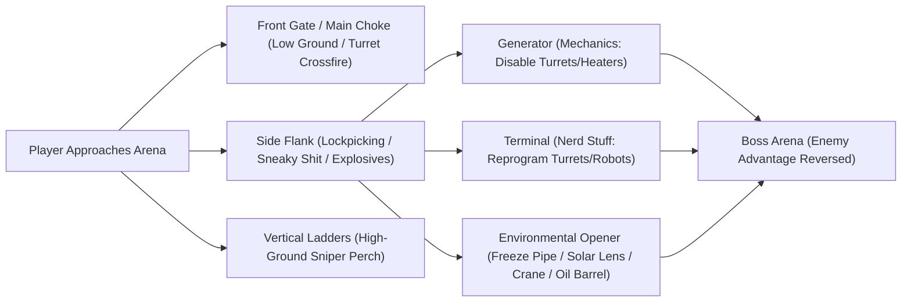

# Wasteland 3 — Comprehensive Level-Design Study & Knowledge Base

> [!IMPORTANT]
> **Inspection & Audit Status: 40 / 40 Locations Visually Inspected (100%)**
> Every single location linked from `https://game-maps.com/W3/Wasteland-3-Maps.asp` was downloaded, its high-resolution map image visually inspected (`scratch/w3_study/maps/*.jpg`), and its full marker/walkthrough data parsed (`scratch/w3_study/parsed/*.md`). Zero locations were skipped or inaccessible.

---

## 1. Complete Audit Ledger (All 40 Inspected Locations)

| # | Location Name | Map Image File Inspected | Region / Hub | Spatial Archetype | Skill Check Tier | Combat Encounters | Status |
| :--- | :--- | :--- | :--- | :--- | :--- | :--- | :--- |
| 01 | **Colorado (World Map)** | `Colorado-Map-Wasteland-3.jpg` | Colorado Overworld | Radiation-Gated Mountain Basin Network | Chassis / Rad Lv 1–3 | Dynamic / Ambush | Inspected |
| 02 | **Ambush Site** | `Ambush-Site-Map.jpg` | Prologue | Linear Canyon Hook + Dam Sabotage Loop | Tier 1 (Ranks 1–2) | 4 Fixed + 1 Optional | Inspected |
| 03 | **Ranger HQ** | `Ranger-HQ-Map.jpg` | Colorado Springs | Evolving Multi-Wing Base Hub | Tier 1–2 (Ranks 1–6) | 2 Early + 2 Crisis | Inspected |
| 04 | **Downtown Colorado Springs** | `Downtown-Colorado-Springs-Map.jpg` | Colorado Springs | Radial Civic Hub + Alley Flanks | Tier 1–2 (Ranks 1–7) | 1–2 Conditional + Crisis | Inspected |
| 05 | **Garden of the Gods** | `Garden-of-the-Gods-Map.jpg` | Colorado Springs | Figure-8 Canyon Loop + High-Ground Lens | Tier 1 (Ranks 1–5) | 3 Fixed + 1 Sabotage | Inspected |
| 06 | **Sans Luxe Apartments** | `Sans-Luxe-Apartments-Map.jpg` | Colorado Springs | Compact Multi-Room Interior Block | Tier 1 (Ranks 1–5) | 1–2 Conditional | Inspected |
| 07 | **Little Vegas** | `Little-Vegas-Map.jpg` | Colorado Springs | Two-Floor Social/Siege Club | Tier 1 (Ranks 1–4) | 2–3 Conditional | Inspected |
| 08 | **Machine Shop** | `Machine-Shop-Map.jpg` | Colorado Springs | Exterior Yard + Sabotage Apron + Bay | Tier 1 (Ranks 1–4) | 2 Fixed | Inspected |
| 09 | **Closed Little Vegas** | `Closed-Little-Vegas-Map.jpg` | Colorado Springs | Mutated Arena (Re-populated Hub) | Tier 2 (Ranks 4–6) | 1 Boss Siege | Inspected |
| 10 | **Broadmoor Heights** | `Broadmoor-Heights-Map.jpg` | Colorado Springs | Gated Citadel Suburb + Bunker Flank | Tier 2–3 (Ranks 3–9) | Non-Combat / End-Game | Inspected |
| 11 | **Patriarch's Palace** | `Patriarchs-Palace-Map.jpg` | Colorado Springs | Formal Throne Axis + Restricted Side Wing | Tier 2–3 (Ranks 6–10) | Non-Combat / End-Game | Inspected |
| 12 | **Old Survivalist Bunker** | `Old-Survivalist-Bunker-Map.jpg` | Colorado Springs | Symmetrical Vault + Side Utility Wings | Tier 2 (Ranks 3–7) | 4 Fixed | Inspected |
| 13 | **The Bizarre Exterior** | `Bizarre-Exterior-Map.jpg` | The Bizarre | Multi-Tiered Bridge Approach + Outer Camp | Tier 2 (Ranks 3–7) | 2 Fixed + 1 Conditional | Inspected |
| 14 | **The Bizarre Interior** | `Bizarre-Interior-Map.jpg` | The Bizarre | Underground Mall Hub (Mutates on Coup) | Tier 2 (Ranks 3–7) | 0 or Full Hub Siege | Inspected |
| 15 | **The Warrens** | `Warrens-Map.jpg` | The Bizarre | Central Locked Objective + 3-Branch Ring | Tier 2 (Ranks 4–7) | 5 Fixed | Inspected |
| 16 | **Denver Ruins** | `Denver-Ruins-Map.jpg` | Denver | Dual-Lobe Split Map (Civic Plaza + Oil Field) | Tier 2 (Ranks 4–8) | 5–6 Conditional | Inspected |
| 17 | **Machine Commune** | `Machine-Commune-Map.jpg` | Denver | Airport Terminal Social Ring + Tower | Tier 2 (Ranks 4–7) | 1 Minor + Dialogue | Inspected |
| 18 | **Aspen** | `Aspen-Map.jpg` | Aspen | Kodiak-Integrated Drawbridge Ring Yard | Tier 3 (Ranks 5–9) | 5 Fixed | Inspected |
| 19 | **Little Hell** | `Little-Hell-Map.jpg` | Aspen | Multi-Level Hotel Gauntlet + Hostage Puzzle | Tier 3 (Ranks 6–10) | 6 Fixed / Conditional | Inspected |
| 20 | **Yuma County Speedway** | `Yuma-County-Speedway-Map.jpg` | Yuma County | Faction Hub + 2 Linked Strike Arenas | Tier 3 (Ranks 7–10) | 3–6 Conditional | Inspected |
| 21 | **Scar Collector Mine** | `Scar-Collector-Mine-Map.jpg` | Yuma County | Killzone Spine vs. 4-Habitat Drone Bypass | Tier 3 (Ranks 7–10) | 3–4 Conditional | Inspected |
| 22 | **Godfisher Windfarm** | `Godfisher-Windfarm-Map.jpg` | Yuma County | Tri-Cluster Camp with Peripheral Flanks | Tier 3 (Ranks 8–10) | 3 Fixed / Conditional | Inspected |
| 23 | **Hoon Homestead** | `Hoon-Homestead-Map.jpg` | World Map (West) | Two-Stage Yard + House Siege with Backdoor | Tier 1 (Ranks 1–4) | 2 Fixed | Inspected |
| 24 | **Arapaho Caravan** | `Arapaho-Caravan-Map.jpg` | World Map (North) | Twin-Lobe Ambush + Flank Minefield | Tier 1 (Ranks 2–3) | 2 Fixed | Inspected |
| 25 | **Monster Army Bunker** | `Monster-Army-Bunker-Map.jpg` | The Bizarre | 4-Switch Radial Vault Unlock Puzzle | Tier 2 (Ranks 4–6) | 4 Fixed | Inspected |
| 26 | **Gett Family Homestead** | `Gett-Family-Homestead-Map.jpg` | World Map (Central) | Farmhouse Standoff + Basement Backdoor | Tier 2 (Ranks 3–6) | 1 Conditional | Inspected |
| 27 | **Snowed Inn Resort** | `Snowed-Inn-Resort-Map.jpg` | World Map (NW) | Dual-Gate Vehicle Unlock + Lodge Ambush | Tier 3 (Ranks 6–10) | 3–4 Conditional | Inspected |
| 28 | **Mysterious Cave** | `Mysterious-Cave-Map.jpg` | World Map (Central) | Single-Chamber Narrative Micro-Site | None | 0 | Inspected |
| 29 | **Cannibal Jamboree** | `Cannibal-Jamboree-Map.jpg` | World Map (East) | Social Infiltration Compound -> Escape Loop | Tier 3 (Ranks 7–8) | 1–2 Conditional | Inspected |
| 30 | **Clown Museum** | `Clown-Museum-Map.jpg` | The Bizarre (East) | Fairground Loop + Big Top Rear Generator | Tier 2 (Ranks 5–7) | 4 Fixed | Inspected |
| 31 | **Santa's Workshop** | `Santa-Workshop-Map.jpg` | World Map (North) | Front Showroom -> Factory -> Rear Escape | Tier 2 (Ranks 5–7) | 2 Conditional | Inspected |
| 32 | **Paint Mines** | `Paint-Mines-Map.jpg` | World Map (Central) | Asymmetric Loop (Mined Choke vs. Ridge) | Tier 2 (Ranks 5–8) | 2 Fixed | Inspected |
| 33 | **Department of Energy Site** | `Department-of-Energy-Site-Map.jpg` | World Map (South) | 3-Corridor Fan + High-Tier Mech Boss | Tier 3 (Ranks 6–8) | 1 Heavy Boss Gauntlet | Inspected |
| 34 | **Ghost Town** | `Ghost-Town-Map.jpg` | World Map (South) | Figure-8 Graveyard + Shrine Puzzle | Tier 2–3 (Ranks 6–10) | 2 Fixed | Inspected |
| 35 | **Abandoned Oil Well** | `Abandoned-Oil-Well-Map.jpg` | World Map (NE) | Atmospheric Zero-Combat Horror Micro-Site | None | 0 (1 World Map Trigger) | Inspected |
| 36 | **Massacre Site** | `Massacre-Site-Map.jpg` | World Map (East) | Zero-Combat Forensic Loot Micro-Site | Tier 3 (Ranks 6–10) | 0 | Inspected |
| 37 | **Tellurium Mine** | `Tellurium-Mine-Map.jpg` | World Map (North) | Dual-Tunnel Mine + Kodiak-Cleared Yard | Tier 3 (Ranks 6–9) | 4 Fixed | Inspected |
| 38 | **Union Station** | `Union-Station-Map.jpg` | World Map (NW) | Two-Floor Bar Stand-off + Sequential Switch Vault | Tier 2–3 (Ranks 4–9) | 3–4 Conditional | Inspected |
| 39 | **Knox Bison Ranch** | `Knox-Bison-Ranch-Map.jpg` | World Map (East) | Open Pasture Gauntlet + Kodiak Support | Tier 3 (Ranks 6–9) | 3 Fixed | Inspected |
| 40 | **Toaster Repair Academy** | `Toaster-Repair-Academy-Map.jpg` | World Map (East) | Zero-Combat Meta-Reward Shrine | Tier 3 (Ranks 8–10) | 0 | Inspected |

---

## 2. Visual Language & Iconography Legend (Extracted from the 40 Maps)

Every map image on `game-maps.com` uses a consistent visual grammar that reveals how *Wasteland 3* layers combat, stealth, and exploration into the same floorplan:

- **Hostile Entities (Red)**:
  - **Small Red Silhouette w/ Rifle**: Standard hostile unit or squad member.
  - **Large Red Silhouette w/ Raised Arms**: Boss, Heavy Mech (Scorpitron, Warbot, Slicer Dicer), or Prime target.
  - **Red Spiky Starburst**: Landmine, tripwire, plasma mine, or explosive floor trap.
  - **Red Square**: Interactive combat prop (Explosive Oil Barrel, Liquid Nitrogen Tank, Turret Control Node, Alarm).
- **Non-Hostile Entities (White / Yellow / Blue / Green)**:
  - **Yellow Silhouette**: Primary Quest Giver / Faction Leader (e.g., The Patriarch, Gideon Reyes, Flab the Inhaler, Reagan AI, Liberty Buchanan).
  - **White Silhouette**: Neutral civilian, hostage, or dialogue NPC.
  - **Blue Silhouette**: Recruitable Companion or Base Staff (e.g., Kwon, Lucia, Jodie Bell, Cordite, Fishlips, Scotchmo).
  - **Green Silhouette**: Merchant / Vendor.
  - **Red Cross in White Circle**: Doctor / Medical Station.
  - **Blue Animal Head**: Tameable Animal Companion (`Animal Whisperer` targets: Major Tomcat, Polly, Billy & Jean, Cyber Chickens, Honey Badger, Goldenplate).
- **Interactive Architecture & Loot**:
  - **Green Padlock**: Lockpickable door, gate, or safe.
  - **Green Lever / Switch**: Power generator, valve, or mechanical switch (`Mechanics` / `Sneaky Shit`).
  - **Green Computer Monitor**: Hackable terminal (`Nerd Stuff` / `Weird Science`).
  - **White Ladder**: Vertical traversal node (rooftop sniper perch, cliff bypass, or backdoor drop-in).
  - **Green Crate**: Standard loot container.
  - **Green Crate w/ Star Circle**: High-value unique item (Skill Book, Cassette Tape, Creepy Doll, Toaster, Unique Weapon/Armor, Quest Key).
  - **Purple Star**: Hidden stash (`Perception` dig site) or secret environmental trigger.

---

## 3. Location-by-Location Visual & Structural Analysis (All 40 Maps)

### Part I: World Map & Prologue

#### 01. Colorado World Map (`Colorado-Map-Wasteland-3.jpg`)
- **Visual Layout & Topology**: A mountainous basin divided by natural canyon walls and **radiation belts** (marked in green hazard zones across the north, northwest, and southeast). Colorado Springs and Ranger HQ sit in the south-central pocket (`[01]`), giving the player a hub with three distinct directional vectors:
  1. **Northeast Low-Radiation Corridor** -> The Bizarre (`[04]`), Monster Army Bunker (`[08]`), Clown Museum (`[13]`), Arapaho Caravan (`[07]`).
  2. **Northern Highway Corridor** -> Denver Ruins (`[05]`), Machine Commune, Ghost Town (`[17]`), Tellurium Mine (`[20]`), Union Station (`[21]`).
  3. **Western/Eastern High-Radiation Corridors** -> Aspen (`[19]`), Snowed Inn (`[10]`), Yuma County (`[25]`), Knox Bison Ranch (`[22]`), Department of Energy (`[16]`).
- **Design Principle**: **Hard Chassis Gates + Soft Encounter Gates**. The World Map uses radiation levels (requiring Kodiak upgrades in the Ranger HQ Garage) as hard gates, while oasis caches, hidden bunkers (`Perception` checks), and wandering merchants reward off-road exploration.

#### 02. Ambush Site (`Ambush-Site-Map.jpg`)
- **Visual Layout**: An S-shaped mountain canyon running from the bottom-center river shore (`START`) up a cliffside switchback to a fortified hydroelectric dam top (`[D]`).
- **Encounter & Chokepoint Breakdown**:
  - **Zone `[A]` / `[01]`–`[02]` (Riverbank Tutorial)**: Immediately introduces low/high cover and verticality (`Ladder` icon between `[01]` and `[02]`). Major Tomcat sits at `[A]` (`Animal Whisperer 1` or Cigarettes), immediately teaching players that pre-combat exploration yields permanent allies.
  - **Zone `[B]` / `[03]` (Central Bend)**: Dorsey and Pvt. Jodie Bell (`[03]`). Introduces the **Dialogue vs. Combat vs. Environmental Hazard triangle**: use `Kiss Ass 1` / `Hard Ass 1` to save the hostage, or detonate the red square **Oil Tank** (`[B]`) to wipe out the cluster.
  - **Zone `[C]` (Dam Access — The First "Sabotage Apron")**: Before reaching the boss at `[D]`, a left-hand branch leads into a control room (`Lockpicking 1` or `Explosives 1` trapped door) containing a **Generator** (`Mechanics 1`) and **Computer** (`Nerd Stuff 1`) that reprogram or shut down the heavy turret at the dam overlook.
  - **Zone `[D]` / `[05]` (Dam Overlook Boss)**: Jarrett Dorsey + heavy turret + high-ground cover. Exiting via `[E]` transitions directly into Ranger HQ.

---

### Part II: Colorado Springs Hub & Early Missions

#### 03. Ranger HQ (`Ranger-HQ-Map.jpg`)
- **Visual Layout**: A sprawling T-shaped Peterson Air Force Base interior centered on the **Exterior Yard (`[A]`)** and **Main Hall (`[B]`)**, with radial wings: **War Room (`[C]`)**, **Garage (`[D]`)**, **Med Bay (`[E]`)**, **Armory (`[F]`)**, **Brig (`[G]`)**, **Museum (`[H]`)**, **Mess Hall (`[I]`)**, and **Server Room (`[J]`)**.
- **Design Principle — The 3-Phase Mutating Hub**:
  1. **Phase 1 (Reclamation)**: When the player first arrives, the side wings are dark, unstaffed, and hazardous—containing radiation/traps in the Med Bay (`[E]`), a hostile **Slicer Dicer** robot in the Server Room (`[J]`) guarding the valuable AI module (`Nerd Stuff 3`), and a dying prisoner in the Brig (`[G]`).
  2. **Phase 2 (Staffing & Growth — *Full House*)**: Each empty room visually populates as the player recruits specialists across the world, turning dead rooms into functional shops, doctors, and lore displays (`Museum` `[H]`).
  3. **Phase 3 (Crisis Battlefield)**: During the Scar Collector attack (`[A]`) and the late-game **Downtown Showdown**, the familiar hub becomes a multi-front tactical combat zone where players must fight from room to room (`Garage [D]`, `Armory [F]`, `Brig [G]`) to hack security terminals and unlock the `War Room [C]`.

#### 04. Downtown Colorado Springs (`Downtown-Colorado-Springs-Map.jpg`)
- **Visual Layout**: A cross-shaped civic market centered on **Market Square (`[D]`)**, flanked by **Sheriff's Office (`[A]`)**, **pillories (`[B]`)**, **Museum (`[C]`)**, **Clinic (`[E]`)**, **Shops (`[F]`)**, and **Garden Side Street (`[H]`)**, with four peripheral sub-map exits (`E1` Ranger HQ, `E2` Broadmoor Heights, `E3` Sans Luxe, `E4` Little Vegas, `E5` Machine Shop, `E6` Garden of the Gods).
- **Hidden Alley Flanks & Puzzles**:
  - **North-West Alley (`[01]`–`[02]`)**: Flipping switch `[01]` sends sparks down the alley to broken wires `[02]` (`Mechanics 3`) to unlock a secret cache behind the Museum—a pure visual environmental puzzle inside a safe town hub.
  - **Back Alleys (`[03]`, `[07]`, `[08]`)**: Quiet cul-de-sacs used for low-tier combat skirmishes (Dorsey holdouts at `[07]`, thugs harassing a civilian at `[08]`, and Casino thugs behind Little Vegas at `[03]`).

#### 05. Garden of the Gods (`Garden-of-the-Gods-Map.jpg`)
- **Visual Layout**: A red-rock canyon arranged as an **asymmetric Figure-8 loop** around a central rock spire.
- **Encounter Pacing & The P.A.L. Solar Lens Sabotage**:
  - **Entry (`[01]`–`[A]`)**: Mass grave discovery -> first Dorsey ambush at a narrow canyon neck (`[01]`). Right branch (`[A]`) holds a **two-person pressure-plate puzzle** (one Ranger stands on the glowing pad to power the terminal while another hacks it for the `12345` safe code).
  - **Middle Fork (`[02]`)**: Cultist/Dorsey checkpoint with dialogue bypass (`Hard Ass 4` / `Weird Science 4`).
  - **Boss Arena (`[05]`) & Secret High-Ground Bypass (`[03]` -> `[04]`)**: Walking straight north from `[02]` into `[05]` puts the squad in a low-ground killbox against **Nelius Dorsey** and his fortified camp. However, spotting the narrow west cliff path at `[03]` leads up to `[04]`, where the **P.A.L. (Planetary Alignment Lens)** console (`Weird Science 1` or `Nerd Stuff 3`) allows the player to **incinerate half the boss encounter with a solar beam before combat even begins**, then attack from high ground.
  - **Return Loop (`[B]` -> `[C]`)**: Connects back down the eastern canyon past the **Workshop (`[B]`)** (`Mechanics 4` generator to disable turrets) and **Watchtower (`[C]`)**.

#### 06. Sans Luxe Apartments (`Sans-Luxe-Apartments-Map.jpg`)
- **Visual Layout**: A compact U-shaped apartment courtyard with three interior suites wrapping around a central lobby (`[A]`).
- **Tactical Density in Small Footprints**:
  - **Irv's Apartment (`[B]`)**: A masterclass in micro-room encounter design. The small room contains 3 hostile clones, a heavy turret, an entry alarm (`Sneaky Shit 4`), **Liquid Nitrogen tanks** (red squares), and a rear **Generator** (`Mechanics 3`). Players who sneak in and disable the alarm/generator or shoot the nitrogen tanks freeze the clones immediately. Afterwards, the room becomes a **squad-split puzzle** (standing on glowing floor pads to operate the cloning machine).
  - **Apartments `[C]` & `[D]`**: Contrast combat with social/investigation encounters (`Kiss Ass 2` / `Hard Ass 3` in `[C]`; `Nerd Stuff 3` radio repair in `[D]`).

#### 07. Little Vegas (`Little-Vegas-Map.jpg`) & 09. Closed Little Vegas (`Closed-Little-Vegas-Map.jpg`)
- **Visual Layout**: A two-level interior split between the **Ground Floor (`[A]` Main Room, `[B]` Stage, `[C]` Backroom, `[E]` Server Room)** and **Upstairs Balcony (`[F]` Bedroom, `[G]` Brygo's Office, `[H]` MacTavish's Room)**.
- **Multi-Path Resolution Architecture**:
  - **Frontal Assault**: Fighting **Faran Brygo** (`[07]`) in his upstairs office alerts the entire ground-floor bar (`[01]`–`[05]`), creating a massive two-story firefight where downstairs thugs rush up the dual staircases.
  - **Non-Lethal Sabotage Loop**: Players can go out the back alley (`[D]`), rescue **Delgado** in the Backroom (`[C]`), unlock the **Server Room (`[E]`)** (`Lockpicking 3`), and either hack the casino terminal (`Nerd Stuff 3`) or sabotage the **Ventilation System** (`Mechanics 4` / `Weird Science 3`) to flood the club with gas—forcing Brygo to surrender peacefully without firing a shot.
  - **Map Re-Use (`Closed Little Vegas`)**: Later in the game, the exact same geometry is boarded up and repurposed as a chaotic enclosed arena against a giant **Scorpitron (`[01]`)** and robot swarm.

#### 08. Machine Shop (`Machine-Shop-Map.jpg`)
- **Visual Layout**: An L-shaped industrial yard (`[A]`) wrapping around a two-room indoor garage (`[B]` Workshop, `[C]` Office).
- **Sabotage Apron & Elevation**:
  - Entering at `E1` faces a fortified yard (`[A]`) with thugs and a central heavy turret.
  - **Left Perimeter Flank**: A side path along the western fence leads to the **Generator** (`Mechanics 1`) that powers down the turret before combat, plus a **Ladder** to a sniper catwalk overlooking `[A]`.
  - **Interior (`[B]`)**: Contains a giant mechanical crane claw (`Mechanics 3` / `Nerd Stuff 4`) that can be dropped directly onto the enemies inside the bay.

#### 10. Broadmoor Heights (`Broadmoor-Heights-Map.jpg`) & 11. Patriarch's Palace (`Patriarchs-Palace-Map.jpg`)
- **Visual Layout**:
  - `Broadmoor Heights` is a high-elevation rich district organized around a central square (`[B]` Tai-Chi / Pillories) with a northern ascent to the Palace (`E3`), western **Church (`[A]`)** and **Bunker (`[E]`)**, and southern ** Wesson Residence (`[D]`)**.
  - `Patriarchs Palace` is a linear ceremonial axis (`Entrance Hall [A]` -> `Throne Room [D]`) flanked by restricted private quarters (`Left Wing [B]`, `Right Wing [C]` guarded by `Lockpicking 7` / `Sneaky Shit 7` / `Nerd Stuff 7`).
- **Design Principle**: **Delayed Payoff Architecture**. Early in the game (Tier 1), players visit Broadmoor Heights and the Palace as peaceful narrative spaces, seeing high-level locked doors (`Rank 7–10`) and turret emplacements (`[06]`–`[07]`). In the finale, this entire civic space transforms into the final siege battlefield where every previously noticed generator, bunker shortcut (`[E]`), and turret terminal becomes a tactical asset.

#### 12. Old Survivalist Bunker (`Old-Survivalist-Bunker-Map.jpg`)
- **Visual Layout**: A classic symmetrical underground vault with a central spine (`Entry [A]` -> `Central Room [B]` -> `Vault Door [E]` -> `Vault [F]`) and two perpendicular wings (`Left Wing [C]` living quarters, `Right Wing [D]` generator/storage).
- **Encounter Flow**:
  - **Entry `[A]`**: Immediate tripwire + landmine gauntlet (`Sneaky Shit 3` / `Explosives 3`) that teaches players not to rush indoor corridors.
  - **Central Room `[B]`**: Heavily fortified bunker shootout with **Explosive Red Barrels** placed beside enemy cover.
  - **Right Wing `[D]` -> Vault `[F]`**: Fighting through the right wing gives access to the **Power Generator (`[02]`)** (`Mechanics 6` or `Nerd Stuff 5`) required to open the massive **Vault Door (`[E]`)** without needing the key from the boss in Left Wing (`[C]`).

---

### Part III: The Bizarre & Surrounding Mid-Game Sites

#### 13. The Bizarre Exterior (`Bizarre-Exterior-Map.jpg`)
- **Visual Layout**: A multi-tiered canyon crossing divided into **South Slum Camp (`[A]`–`[B]`)**, **Frozen Riverbed (`[C]`)**, **Fortified Bridge (`[D]`)**, and **North Entrance Plaza (`[E]`)**.
- **Encounter & Chokepoint Design**:
  - **The Bridge Chokepoint (`[D]`)**: One of the sharpest chokepoints in the game—enemies hold high ground on the far side of a narrow bridge lined with explosive barrels and turrets (`[04]`–`[06]`).
  - **Flank Under the Bridge (`[C]`)**: Players can drop down into the frozen canyon floor (`[C]`), clear a group of Frost Creep ambushers (`[03]`), loot a hidden safe, and climb a **Ladder** on the north side to flank the bridge defenders (`[05]`) or reach the turret generator (`Mechanics 6`).

#### 14. The Bizarre Interior (`Bizarre-Interior-Map.jpg`)
- **Visual Layout**: A circular underground shopping mall with a central **Food Court / Market Hub (`[B]`)** surrounded by specialist shops (`[C]` Noodle Stand, `[D]` Clothes, `[E]` Clinic, `[F]` Weapons, `[G]` Mechanics) and an upper **Monster Army HQ (`[H]`)**.
- **Design Principle — The Social Hub That Becomes a War Zone**: Like Little Vegas and Ranger HQ, the Bizarre Interior serves as a dense shopping and quest-giving hub first. However, depending on whether the player sides with **Flab the Inhaler (`[H]`)** or **Charley Knowes**, the entire circular market gallery turns into a massive multi-level shootout where shop stalls become cover and turrets activate across the plaza.

#### 15. The Warrens (`Warrens-Map.jpg`)
- **Visual Layout**: A masterclass in **Ring-and-Spoke Dungeon Topology**. The map forms a rough circle around a central locked objective (**`[F]` Chapel / Dental Clinic**) that is sealed by a security terminal (`[10]`) requiring a **3-part Limerick Passcode**.
- **The 3-Branch Exploration Loop**:
  1. **West Branch (`[B]` Sub-Station -> `[C]` Playroom)**: Pigaledon encounter (`Explosives 5` / `Animal Whisperer 5` to turn the giant explosive-strapped hog against the Payasos) + **Limerick Part 1 (`[03]`)** + recruiting **The Provost (`[04]`)**.
  2. **South-Central Branch (`[D]` Butcher Shop)**: Gas minefield (`Explosives 4`) + Payaso ambush (`[06]`) + **Limerick Part 2 (`[07]`)**.
  3. **North-East Branch (`[E]` Diner / Furnace)**: Heavily fortified Payaso squad (`[08]`) + **Generator** (`Mechanics 6` to disable turrets) + **Limerick Part 3 (`[09]`)**.
- **Boss Payoff (`[F]`)**: Only after visiting all three thematic branches (or bypassing via high-tier skill checks) does the central door `[10]` open for the boss fight with **Roach (`[11]`)**, directly connecting out to `[G]` (back entrance to the Bizarre Interior).

#### 25. Monster Army Bunker (`Monster-Army-Bunker-Map.jpg`)
- **Visual Layout**: A compact, radial 5-room subterranean bunker (`[A]` Entry -> `[B]` Central Hall -> `[C]` Living Quarters, `[D]` Screening Room, `[E]` Storage/Generator) accessed from the Warrens (`E1`).
- **4-Switch Radial Puzzle**: The central **Screening Room (`[D]`)** is blocked by **four color-coded laser barriers**. To open it, the player must clear four surrounding micro-encounters (Waste Wolves in `[01]`, Payasos in `[03]`, Bomb Hoppers in `[04]`, and a radiation/generator room in `[06]`) and flip all four switches (`[02]`, `[03]`, `[05]`, `[06]`).

#### 30. Clown Museum (`Clown-Museum-Map.jpg`)
- **Visual Layout**: An outdoor carnival ring looping around a massive central **Circus Big Top (`[C]`)**, flanked by **Fairground Stalls (`[A]`)**, **Bowling Alley (`[B]`)**, and **Pig Farm (`[D]`)**.
- **Key Level-Design Patterns**:
  - **Squad-Split Electrical Puzzle (`[04]`–`[05]`)**: Standing one character on the illuminated star at the end of the bowling lane (`[04]`) routes power to the locked shed door (`[05]`).
  - **The Classic Rear-Tent Sabotage Apron (`[08]` -> `[09]`)**: Entering the Big Top from the main gate (`[08]`) walks straight into **Panzon (`[10]`)**, dozens of Payasos, and **3 heavy turrets**. However, circling outside along the southern fence (`[09]`) reveals a torn flap in the back of the circus tent (`Sneaky Shit 5` alarm) right next to the **Turret Generator (`Mechanics 5`)**, letting the squad disable all three turrets and ambush the boss from behind.
  - **Collection Micro-Quest**: 4 **Ballerina Gyros** scattered across different combat zones (`[01]`, `[03]`, `[07]`, `[11]`) repair the music box at `[02]`.

---

### Part IV: Denver Ruins & Machine Commune

#### 16. Denver Ruins (`Denver-Ruins-Map.jpg`)
- **Visual Layout**: A monumental **Dual-Lobe Map** split down the middle by ruined buildings:
  - **East Lobe (Civic Axis)**: **Arrival Court (`[A]`)** -> **Western White House (`[C]`)** beneath the giant **Reagan Statue (`[D]`)**, whose laser gaze sweeps the plaza (`[B]`).
  - **West Lobe (Industrial Axis)**: **Ruined Trenches (`[E]`–`[F]`)** -> **Oil Field (`[G]`)** and **Power Bunker (`[H]`)**.
- **Tactical & Environmental Brilliance**:
  - **The Reagan Statue Environmental Threat**: The boss of the civic plaza is literally the architecture—the giant Reagan statue (`[D]`) fires a devastating laser across `[B]` unless the player fulfills its objectives in the west lobe or hacks/redirect its power in `[C]`.
  - **Multi-Route Entry into the Oil Field (`[G]`)**: To reach the Godfisher ritual at `[G]` and `[H]`:
    - *Route 1 (Front Choke)*: Pick the `Lockpicking 5` gate at `[12]` and charge uphill into crossfire.
    - *Route 2 (Southern Cave Flank)*: Enter the cave at `[13]`, disable the **Flame Generator** (`Mechanics 4` at `[14]`), and emerge on the elevated southern ridge behind the Godfishers.
    - *Route 3 (Environmental Opening Shot)*: Repair/turn the **Broken Water Pipe (`[16]`, `Mechanics 5`)** overlooking `[G]` to spray the entire Godfisher war party with freezing water before Turn 1, inflicting the *Frozen* debuff across the enemy squad.

#### 17. Machine Commune (`Machine-Commune-Map.jpg`)
- **Visual Layout**: A circular airport baggage/concourse loop (`[A]`–`[F]`) with a northern tarmac exit to the **Airport Control Tower (`[G]`)**.
- **Design Principle — Investigative Dialogue Hub**: Almost zero combat (only a tiny waste-wolf corner at `[08]` behind locked gates `[07]`). Instead, the circular concourse hosts 6 distinct eccentric AI personalities (`[01]`–`[06]`, `Nerd Stuff` / `Weird Science` / `Mechanics` checks) that act as witnesses in a philosophical Turing trial conducted by the **Control Tower AI (`[10]`)**. It provides an immediate tonal and pacing breather after the intense combat of Denver Ruins.

---

### Part V: Aspen & Little Hell (Two-Map Linked Stronghold)

#### 18. Aspen (`Aspen-Map.jpg`)
- **Visual Layout**: A large outdoor valley divided by a frozen river canyon:
  - **South Bank**: **Entry Parking Lot (`[A]`)**, **Gift Shop (`[B]`)**, **Chairlift Station (`[C]`)**, and **Raised Drawbridge (`[09]`)**.
  - **North Bank**: **Fortified Bunker (`[D]`)**, **East Canyon Flank (`[E]`)**, and **Little Hell Hotel Forecourt (`[F]`)**.
- **Vehicle-Integrated Asymmetric Loop**:
  - At start (`[A]`), the main **Drawbridge (`[09]`)** is raised, preventing the **Kodiak** from crossing.
  - The squad must leave the Kodiak behind, fight through the **Gift Shop (`[B]`)** or **East Canyon (`[E]`)**, cross the narrow infantry plank bridge (`[06]`), battle uphill past the **Bunker (`[D]`)**, and hit the **Drawbridge Switch (`[09]`)** from the north side (`Mechanics 6`).
  - Once lowered, the **Kodiak drives across the river into `[F]`**, turning a deadly uphill hotel forecourt siege (`[12]`–`[14]` with turrets and Psychos) into a combined-arms vehicle battle.

#### 19. Little Hell (`Little-Hell-Map.jpg`)
- **Visual Layout**: A sprawling, multi-corridor luxury hotel interior wrapped around a central courtyard/atrium, culminating in **Vic Buchanan's Penthouse (`[M]`)**.
- **High-Stakes Hostage & Hazard Integration**:
  - **5 Hostages Tied to Map Mechanics**: Unlike standard dungeons, Little Hell links combat tactics directly to narrative consequences—5 VIP hostages (`[03]`, `[08]`, `[11]`, `[13]`, `[16]`) are held in different rooms guarded by **Breather** bosses (`Oak [A]`, `Ash [B]`, `Redwood [F]`, `Magnolia [I]`, `Pine [K]`).
  - **Central Security Hub (`[B]` Ash's Room)**: Reaching `[B]` early lets the player access the hotel's master switches and computers (`Nerd Stuff 7`, `Mechanics 7`), opening vault doors (`[C]`) and disarming hallway gas traps (`[J]`).
  - **Two-Person Trap Corridors (`[05]` & `[J]`)**: Hallways filled with poison gas mines and pressure plates require splitting one high-`Sneaky Shit` / `Explosives` operative ahead to hit the valve/generator at the far end while the squad waits in safety.
  - **Boss Room Sabotage (`[L]` -> `[M]`)**: Before confronting **Vic Buchanan (`[18]`)** in `[M]`, a side room (`[L]`) contains a computer (`Nerd Stuff 8`) and generator (`Mechanics 8`) that turn Vic's own room turrets against his bodyguards.

---

### Part VI: Yuma County (Late-Game Faction Triangle)

#### 20. Yuma County Speedway (`Yuma-County-Speedway-Map.jpg`)
- **Visual Layout**: A non-linear faction compound organized around a **Central Pit / Staging Area (`[A]`–`[C]`)**, flanked by three gang camps (**Scar Collectors `[D]`**, **Godfishers `[E]`**, **Payasos `[F]`**) and **Liberty Buchanan's Garage (`[G]`)**, with exits to `E2` (Scar Collector Mine) and `E3` (Godfisher Windfarm).
- **Social Manipulation -> Multi-Map Payoff**: Instead of forcing an immediate frontal assault against three combined armies, the Speedway acts as a **social sabotage hub**. By investigating the gang camps (`[D]`, `[E]`, `[F]`) and completing objectives in the two sub-maps (`E2`, `E3`), the player fractures the Plains Gangs coalition so they turn on each other before the final confrontation with **Liberty Buchanan (`[G]`)** and her twin Warbots.

#### 21. Scar Collector Mine (`Scar-Collector-Mine-Map.jpg`)
- **Visual Layout**: A bifurcated underground complex with a **Right Main Mine Shaft (`[B]`)** and a **Left 4-Habitat Ring (`[C]` Living -> `[D]` Security -> `[E]` Science -> `[F]` Command)** joining at the northern **Slaver Pen (`[G]`)**.
- **The Ultimate Sabotage Bypass**:
  - **The Obvious Trap (`[B]`)**: The central mine shaft is packed with landmines, tripwires, high-ground snipers (`[03]`–`[05]`), and barricades.
  - **The Habitat Flank (`[C]` -> `[D]` -> `[E]` -> `[F]`)**: Taking the western door (`Lockpicking 7` or key from `[02]`) into the pre-war habitats allows the player to repair the **Power Generator (`[06]`, `Mechanics 7`)**, sneak into the **Security Habitat (`[D]`, `Lockpicking 9`, `Sneaky Shit 9`)**, and hack the **Master Security Terminal (`[08]`, `Nerd Stuff 9`)**—which **activates a pre-war Soviet Robot and security drone army that marches into `[E]` and `[F]` and slaughters the Scar Collectors for you**.

#### 22. Godfisher Windfarm (`Godfisher-Windfarm-Map.jpg`)
- **Visual Layout**: An open, wind-swept plateau split into **Three Sacrificial Kite Clusters (`[B]` South-West, `[C]` North-West, `[D]` East)** connected by narrow ridges and cliff ladders.
- **Tri-Node Encounter Design**: Each cluster holds a prisoner tied to a giant wind-kite control winch (`[03]`, `[06]`, `[09]`) guarded by a Godfisher sub-boss (`Star-that-Burns`, `Cloud-that-Chokes`, `Wind-that-Cuts`). Narrow side paths with **Ladders** and **Explosive Barrels** allow the squad to approach each camp from elevated rock shelves rather than marching through the central valley (`[A]`).

---

### Part VII: World Map Side Locations, Homesteads & Micro-Sites

#### 23. Hoon Homestead (`Hoon-Homestead-Map.jpg`) & 24. Arapaho Caravan (`Arapaho-Caravan-Map.jpg`)
- **Visual Design**:
  -Both are **Heads-or-Tails Choice Sites** from Act 1 (saving one means the other is overrun).
  - `Hoon Homestead` uses a classic **Two-Stage Yard + House** layout: clear the front yard (`[A]`), then instead of charging through the front door (`[B]`) into Erastus Dorsey's crossfire, circle around the western rock path (`[03]`), disarm the mines (`Explosives 2`), repair the **Power Generator (`[04]`, `Mechanics 3`)** to overload the house electronics, and enter through the side bedroom door (`Lockpicking 3`).
  - `Arapaho Caravan` uses a **Twin-Lobe Canyon** where the southern ambush (`[A]`) connects to the northern convoy cage (`[B]`) via two routes: a wide central killzone road vs. a mined western cliff ledge (`[03]`) with a **Turret Control Computer (`[05]`, `Nerd Stuff 3`)**.

#### 26. Gett Family Homestead (`Gett-Family-Homestead-Map.jpg`)
- **Visual Layout**: A fenced ranch yard (`[A]`) in front of a farmhouse (`[B]`) with a hidden **Rear Cellar Entrance (`[C]`)**.
- **Design Pattern**: A tense hostage standoff at the front porch (`[02]`, `Kiss Ass 4` / `Hard Ass 5` / `First Aid 4`). If the player explores the right-hand perimeter outside the fence (`[04]`–`[05]`), they can enter the **Cellar (`[C]`)**, sneak directly behind the kidnappers inside the house, or free the captive synth before negotiations break down.

#### 27. Snowed Inn Resort (`Snowed-Inn-Resort-Map.jpg`)
- **Visual Layout**: A symmetrical mountain lodge compound with a **Central Courtyard (`[04]`)** blocked by two heavy security gates, flanked by **Left Cabin (`[01]`)** and **Right Cabin (`[02]`)**, leading up to the **Main Lodge (`[06]`)**.
- **Two-Gate Vehicle Unlock Puzzle**: The central courtyard (`[04]`) contains a lethal **Dorsey Warbot**, heavy turrets, and snipers. By clearing or sneaking into the **Left Cabin (`[01]`)** and **Right Cabin (`[02]`, via rear ladder/lockpick)** first and hitting both gate switches, the **Kodiak** can roll straight into `[04]`, crushing the Warbot and providing mobile heavy cover.

#### 28. Mysterious Cave (`Mysterious-Cave-Map.jpg`), 35. Abandoned Oil Well (`Abandoned-Oil-Well-Map.jpg`), 36. Massacre Site (`Massacre-Site-Map.jpg`), & 40. Toaster Repair Academy (`Toaster-Repair-Academy-Map.jpg`)
- **Visual Layout**: Compact, single-screen **Zero-Combat Punctuation Maps**.
- **Why They Exist (Pacing & Worldbuilding)**:
  - `Mysterious Cave`: A single glowing subterranean grotto where **The Provost** unlocks the **Ancient Stone (`[01]`)** (if you kept him alive since the Warrens), granting the *Owl of Minerva* trinket.
  - `Abandoned Oil Well`: An eerie, blood-soaked camp (`[01]`–`[04]`) with zero enemies inside the map itself, building dread through environmental logs before triggering a **Juvenile Scorpitron** ambush the moment you step back onto the World Map.
  - `Massacre Site`: A slaughtered caravan loop (`[01]`–`[05]`) filled with high-tier skill checks (`Lockpicking 9`, `Toaster Repair 8`, `Mechanics 6`) that tells a silent story and rewards exploration skills without requiring a single bullet.
  - `Toaster Repair Academy`: A golden temple shrine unlocked only after assembling the **Courageous Toaster** across the campaign—pure celebratory reward space.

#### 29. Cannibal Jamboree (`Cannibal-Jamboree-Map.jpg`) & 31. Santa's Workshop (`Santa-Workshop-Map.jpg`)
- **Visual Layout**: Both use the **Social Front -> Dark Backroom -> Fighting Retreat** layout:
  - `Cannibal Jamboree` starts as a polite barbecue (`[A]`–`[B]`) where the player can mingle with the gastro-cannibals (`[01]`–`[04]`), slip through the back door (`[C]`) into the **Butcher Shed & Prisoner Pens (`[D]`–`[E]`)**, disable the generator (`Mechanics 7`), free the captives, and then fight back out through the now-hostile compound.
  - `Santa's Workshop` presents a festive front cottage (`[A]`), leads into an **Elf Slave Factory (`[B]`–`[C]`)** where the player can hack the **Toy Manufacturing Terminal (`[05]`, `Nerd Stuff 6` / `Weird Science 5`)** and free the elves (`[06]`), who help fight Santa's killer robot squad on the way to the rear exit (`[D]`).

#### 32. Paint Mines (`Paint-Mines-Map.jpg`) & 34. Ghost Town (`Ghost-Town-Map.jpg`)
- **Visual Layout**: Outdoor natural loops built around **weird-science anomalies**:
  - `Paint Mines` splits at the RV (`[02]`): the right canyon (`[05]`) is heavily mined, while the left high ridge (`[01]`) lets the squad ambush the **Volatile/Glowing Frogs** from elevation. After combat, a **two-character radio puzzle** requires one Ranger to operate the hilltop antenna (`[04]`) while another sits inside the RV (`[03]`) to transcribe the Morse code reward coordinates.
  - `Ghost Town` is a Figure-8 graveyard (`[A]`–`[D]`) where fighting **Waste Wolves (`[02]`)** and **Drools (`[05]`)** bookends a quiet spiritual shrine (`[04]`).

#### 33. Department of Energy Site (`Department-of-Energy-Site-Map.jpg`)
- **Visual Layout**: A compact, triangular **3-Corridor Fan** radiating from a blast door entry (`[01]`) into a massive central reactor room (`[03]`).
- **Pure Boss Arena Design**: Minimal filler—opening the blast door reveals a **Level 18 Scorpitron**, Octotrons, and turrets (`[03]`). The three diverging side corridors (`Left [02]`, `Center [03]`, `Right [04]`) provide immediate flanking lanes, explosive nitrogen tanks, and a **Generator/Terminal (`[04]`, `Mechanics 7` / `Nerd Stuff 6`)** so the squad can split up and avoid getting wiped by the Scorpitron's cone AoE.

#### 37. Tellurium Mine (`Tellurium-Mine-Map.jpg`), 38. Union Station (`Union-Station-Map.jpg`), & 39. Knox Bison Ranch (`Knox-Bison-Ranch-Map.jpg`)
- **Visual Layout**: Late-game mid-to-large combat arenas:
  - `Tellurium Mine`: Combines an **Exterior Kodiak Yard (`[A]`–`[B]`)** with a **Two-Tunnel Underground Mine (`[C]`–`[F]`)** where poison gas clouds (`[D]`) can be vented via a generator (`Mechanics 7`) before fighting the Razorback nest (`[F]`).
  - `Union Station`: A two-floor train depot where **Fishlips (`[03]`)** challenges the squad in the central hall (`[B]`) while snipers line the **Upper Balconies (`[D]`–`[E]`)**. Behind the bar (`[C]`), a **4-Switch Sequential Puzzle (`1 -> 2 -> 3 -> 4` in Utility Room `[F]`)** powers the secret bookcase door into the **Morningstar AI Bunker (`[G]`)**.
  - `Knox Bison Ranch`: A wide-open pastoral battlefield (`[A]`–`[D]`) where the **Kodiak** fights alongside the squad across three progressive defensive lines of Scar Collectors (`[02]`, `[04]`, `[06]`) to save the bison herd.

---

## 4. Extracted Core Level-Design Principles (The Knowledge Base)

### Principle 1: The Five Spatial Topologies of *Wasteland 3*

Across all 40 maps, the developers never build featureless grid rooms or endless procedural mazes. Every location belongs to one of **five deliberate topological archetypes**:

```mermaid
flowchart TD
    subgraph T1["1. Hook-Loop Tutorial (Ambush Site, Garden of Gods)"]
        A1["Entry Choke"] --> A2["Mid Encounter + Hazard"]
        A2 --> A3["Main Boss Killbox"]
        A2 -. "Secret / Skill Flank" .-> A4["Sabotage Node (Generator/Lens)"]
        A4 ==>|"High-Ground Ambush"| A3
    end

    subgraph T2["2. Asymmetric Ring Dungeon (Warrens, Bunker, Aspen)"]
        B1["Central Locked Objective"]
        B2["West Branch (Key/Code 1)"]
        B3["South Branch (Key/Code 2)"]
        B4["East Branch (Generator/Code 3)"]
        B2 --> B3 --> B4 --> B1
    end

    subgraph T3["3. Mutating Social Hub (Ranger HQ, Little Vegas, Bizarre)"]
        C1["Phase 1: Unstaffed / Hazardous Reclamation"] --> C2["Phase 2: Populated Commerce & Quest Spine"]
        C2 --> C3["Phase 3: Multi-Room Crisis Battlefield"]
    end
```

1. **The Linear Hook with Sabotage Loop** (`Ambush Site`, `Garden of the Gods`, `Machine Shop`, `Hoon Homestead`): A clear forward spine where the final encounter is intentionally lethal from the front, training the player to scan the perimeter for a side loop before initiating combat.
2. **The Evolving / Mutating Hub** (`Ranger HQ`, `Downtown`, `Little Vegas`, `Bizarre Interior`, `Broadmoor Heights`): A social center built with real cover geometry, flanking alleys, and turret generators already embedded in the environment so it can later transform into a combat map.
3. **The Asymmetric Ring / 3-Key Hub** (`Warrens`, `Monster Army Bunker`, `Old Survivalist Bunker`, `Aspen`): Put the locked goal door right near the entrance so the player sees what they are working toward immediately, then loop the dungeon around it in 2–4 distinct thematic branches.
4. **The Combined-Arms Vehicle Siege Yard** (`Snowed Inn Resort`, `Aspen`, `Denver Ruins`, `Tellurium Mine`, `Knox Bison Ranch`): Pair a wide exterior vehicle yard (where the Kodiak dominates) with tight infantry-only side buildings or tunnels that hold the gate switches/generators blocking the vehicle.
5. **The Zero-Combat Punctuation Micro-Site** (`Mysterious Cave`, `Abandoned Oil Well`, `Massacre Site`, `Toaster Repair Academy`): Short, 1-room atmospheric locations on the overworld that reward non-combat skills and prevent combat fatigue between major dungeons.

---

### Principle 2: The "Pre-Combat Sabotage Apron" (Signature Encounter Formula)

In *Wasteland 3*, a major combat room is almost never just a box with enemies inside. Instead, every major encounter is wrapped in a **"Sabotage Apron"**—an outer buffer zone containing 3 to 4 interactive layers before the first shot is fired:

- **Rule of 3 Entry Vectors**:
  1. **The Obvious Frontal Choke (0 Skill Required)**: Walks into low ground, alarms, or turret crossfire (allows brute-force combat builds or dialogue checks via `Kiss Ass` / `Hard Ass`).
  2. **The Elevation Flank (`Ladder` / Ridge)**: Puts 1–2 squad snipers on an elevated catwalk or cliff ledge (`+Hit Chance`, `+Crit`, immunity to melee rushers).
  3. **The Sabotage Backdoor (`Mechanics` / `Nerd Stuff` / `Lockpicking` / `Sneaky Shit`)**: Lets a specialist sneak behind or beside the arena to **disable the generator** (`Mechanics`) or **hack the turret/robot terminal** (`Nerd Stuff`) so the enemy's own defenses turn against them on Turn 1.
- **The Environmental Opening Shot**: Give the player a single spectacular environmental trigger to initiate combat instead of just shooting a rifle:
  - Freezing water pipe (`Denver Ruins [16]`)
  - Overhead crane drop (`Machine Shop [B]`)
  - Solar alignment beam (`Garden of the Gods [04]`)
  - Liquid nitrogen tanks (`Sans Luxe [B]`, `Department of Energy [03]`)
  - Explosive pig release (`Warrens [02]`)

---

### Principle 3: Multi-Character Spatial Puzzles (Tactical Squad Splitting)

Because the player controls multiple characters on a grid/isometric map, *Wasteland 3* uses **spatial separation puzzles** to make exploration feel tactile:
1. **Live-Power Pressure Pads** (`Garden of the Gods [A]`, `Sans Luxe [B]`, `Clown Museum [04]`): A computer or locked door has no power unless a heavy weight (one character) stands on a floor plate 15–20 meters away while a second character interacts with the terminal/door.
2. **Transmitter & Receiver Separation** (`Paint Mines [03]`–`[04]`): One character operates a physical mechanism outside (hilltop radio antenna) while a second character sits at the receiver inside an interior room (RV radio) to read the output.
3. **Trace-the-Cable / Spark Routing** (`Downtown [01]`–`[02]`, `Union Station [F]`): Flipping a switch sends visible electrical sparks along floor conduits to show the player *where* the broken junction box or sequential switch (`1 -> 2 -> 3 -> 4`) is hidden.
4. **Solo Infiltrator Trap Corridors** (`Little Hell [05]/[J]`, `Scar Collector Mine [D]`): A narrow mined/gassed hallway where moving the whole squad is a liability, encouraging the player to unlink their stealth/explosives specialist to reach the shutoff valve at the end of the hall.

---

### Principle 4: Multi-Horizon Exploration Incentives & Cross-Map Loops

Exploration containers in *Wasteland 3* are never just random vendor trash. Every map layers **three reward horizons**:
1. **Immediate Tactical Payoff (Within the Current Room)**: Keys, safe combinations (`12345`), turret passwords, and medical/ammo resupplies placed *right before* or *inside* the sabotage apron of a tough fight.
2. **Permanent Character Progression (Within the Current Map)**:
   - **Skill Books** (placed in the final vault or boss safe of almost every location).
   - **Creepy Dolls** (15 total, granting permanent passive squad-wide buffs like `+5% Crit Resistance` or `+10% Sneak Attack Damage`, always hidden in off-path corners).
   - **Cassette Tapes** (worldbuilding voice logs that frequently contain a spoken password or safe hint).
   - **Tameable Unique Animals** (Major Tomcat, Polly, Cyber Chickens, Honey Badger, Billy & Jean).
3. **Cross-Map Meta Mysteries (Spanning 20+ Hours)**:
   - **The Provost + Ancient Artifact** (`Warrens [04]` -> `Snowed Inn [03]` -> `Mysterious Cave [01]`).
   - **5 Cyborg Chickens -> Poultron** (`Ranger HQ`, `Garden of Gods`, `Sans Luxe`, `Broadmoor Church`, `Bunker` -> merges at Ranger HQ coop during the finale).
   - **5 Golden Toaster Parts -> Courageous Companion** (`Aspen`, `Paint Mines`, `Knox Ranch`, `Abandoned Oil Well`, `Massacre Site` -> unlocks `Toaster Repair Academy`).
   - **Satoshi's Mysterious Case** (`Sans Luxe` -> held all game without opening -> rewarded near endgame).

---

### Principle 5: Difficulty, Skill-Check & Encounter Density Pacing Curve

| Campaign Phase | Skill Check Ranks | Combat Encounters / Map | Enemy Composition & Hazards | Pacing Rhythm |
| :--- | :--- | :--- | :--- | :--- |
| **Tier 1 (Act 1: Colorado Springs)** | **Ranks 1–5** (occasional Rank 6–7 teaser locks in hubs) | **1–3 encounters** (compact, 4–6 enemies per group) | Human raiders (Dorseys, Casino Thugs), Waste Worms, basic Turrets, Red Oil Barrels. | 1 Hub (`Downtown`) : 3 Short Tactical Maps (`Garden`, `Machine Shop`, `Little Vegas`). |
| **Tier 2 (Mid-Game: Bizarre & Denver)** | **Ranks 4–8** | **4–6 encounters** in dungeons; **0–1** in paired hubs | Elemental hazards (Liquid Nitrogen, Poison Gas Mines, Flame Jets, Freezing Pipes), Bomb Hoppers, Heavy Payasos, Synths. | Every dense 5-fight dungeon (`Warrens`, `Denver`) is immediately paired with a calm social/puzzle hub (`Bizarre Interior`, `Machine Commune`). |
| **Tier 3 (Late-Game: Aspen, Yuma, High Plains)** | **Ranks 7–10** | **5–6 encounters** in strongholds **OR 0 encounters** in micro-sites | Combined arms (Scorpitrons, Warbots, Slicer Dicers, Clone Swarms) + Hostage survival timers. | Alternates massive 2-part gauntlets (`Aspen` + `Little Hell`, `Yuma` + `Mine`/`Windfarm`) with 0-combat atmospheric discovery sites (`Massacre Site`, `Oil Well`). |

---

## 5. Actionable Level-Design Blueprints for *Silo 81*

Using the principles extracted above (without copying any *Wasteland 3* map), here is how we should architect the current and upcoming locations of **Silo 81**:

### A. Upgrading Silo 81 (Levels 1–3) into a "Mutating Hub" (Principle 1 & 4)
- **Current State**: Silo 81 already has Level 2 (Residential / Council / Overseer's Office / Dorms) and Level 3 (Maintenance / Pipe Corridor / Heating Control Room).
- **Wasteland 3 Enhancements to Apply**:
  1. **Deferred High-Tier Locks in the Hub**: Place 1–2 visibly locked doors or high-security terminals on Level 2 (e.g., *Founder's Archive* or *Sealed Medical Cold Storage*) that require tools/codes found later in the surface expedition, giving the player a reason to eagerly return to explored Silo corridors.
  2. **Trace-the-Conduit Visual Clues**: In the **Heating Control Room**, use visible floor cables/steam pipes leading from the main regulator to a secondary auxiliary junction room so the player reads the environment spatially rather than just following UI markers.
  3. **Crisis State Preparation**: Design the furniture and central tables of Level 2 (Council Room, Corridor intersections) with genuine half/full isometric cover metrics so that when an internal crisis or lower-level breach happens later in the story, Level 2 functions seamlessly as a tactical combat map.

### B. Original Blueprint 1: *Sub-Level 4 — Geotherm Pump & Filtration Ring* (Early Dungeon — Tier 1/2)
- **Topological Archetype**: **Asymmetric Ring with Central Locked Objective** (inspired by the structural logic of *The Warrens* & *Old Survivalist Bunker*, adapted to Silo 81's Soviet-industrial underground aesthetic).
- **Layout & Flow**:
  - **Central Spine (`[A]` Pump Lift -> `[B]` Main Geotherm Regulator Seal)**: Immediately in front of the elevator is the jammed main pressure bulkhead (`[B]`), which cannot open until **two auxiliary pressure locks (West Wet-Well & East Electrical Substation)** are equalized.
  - **West Branch (Wet-Well & Worm Nest)**: Flooded grating walkways with matured pipe worms and toxic condensation vents. Includes a **Sabotage Apron**: a raised catwalk ladder where the player can turn a steam purge valve (`Weld Kit` / `Mechanics`) to scald the worm cluster in the pit below before combat starts.
  - **East Branch (Electrical Substation & Rogue Maintenance Drone)**: Contains an automated pre-collapse turret/welding drone gone haywire. Features a **Two-Vector Entry**: walk through the main blast doorway into the turret's cone, or crawl through the rear cable trench (` Room-Fade` side corridor) to pull the capacitor fuse behind the turret.

### C. Original Blueprint 2: *The Surface Transit Depot & Frozen Switchyard* (First Expedition Map — Tier 2)
- **Topological Archetype**: **Linear Hook + Dual-Lobe Sabotage Yard** (combining the pacing of *Ambush Site* and *Denver Ruins* into an original surface railway/heating-parts depot).
- **Layout & Flow**:
  - **Zone 1 (Silo Surface Hatch & Snow Trench)**: Quiet atmospheric emergence from Silo 81 into snowdrifts and rusted rail cars (zero combat for the first 60 seconds to let environmental storytelling breathe—frozen skeletons at the barricade, old evacuation notices).
  - **Zone 2 (The Switchyard Killbox & Sabotage Apron)**: Scavengers/hostiles hold the central locomotive turntable where the replacement heating regulator coils are stored.
    - *Frontal Approach*: Across open rail tracks under heavy overwatch.
    - *North Signal Box Flank*: Climb the signal tower ladder to release a decoupled freight car down the sloped track (`Mechanics` / lever), smashing through the enemy barricade and creating new mobile cover across the center of the yard.
    - *South Boiler Shed Flank*: Repair a ruptured high-pressure steam line so it vents freezing fog across the enemy sniper platform on Turn 1.
- **Reward Loop**: Inside the depot foreman's safe, alongside the heating replacement parts for Silo 81, the player discovers a **dispatch manifest + magnetic keycard** pointing to a pre-war municipal facility—hooking the next act's multi-map mystery.
